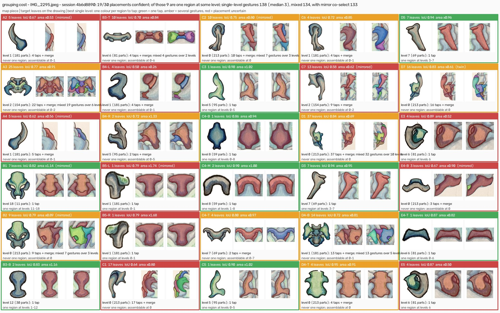

# Grouping cost - IMG_2295.jpeg - session 4b6d8890

How many gestures the review UI, as built, needs to assemble each chunk of the artist's map. A *tap* selects a region, *merge* is the Merge button, a *level change* is one slider move. The single-level number stays on one slider position; the mixed plan taps the largest clean regions at a coarse level, merges, then descends for the rest.

## Summary

- 30 chunks on the map, 213 atomic leaves in the drawing; map to drawing scale 3.0288 working px per map px (102/155 confident matches agree).
- Placement confident (leaf IoU >= 0.70 and area ratio in 0.6-1.6) for 19/30; uncertain: A2, A4, B3-T, B4-L, B5-L, B5-R, C1, C7, E3, E4-B, E5. Placed through the twin map: D7. Duplicate targets: B5-L/B5-R.
- Confident placements (19 chunks): size 1-37 leaves, median 4 (histogram: 1: 4, 2: 3, 4: 3, 7: 3, 9: 1, 10: 1, 14: 1, 16: 1, 25: 1, 37: 1); 9/19 are one region at some slider level (one tap).
  Single level: 128 taps, 138 gestures in all (median 3, max 38). Mixed levels: 134 gestures (median 4, max 32); 133 when a chunk's mirror twin rides along for free (2 twin pairs found: C3/C5, E3/E5).
- All placements (30 chunks): size 1-37 leaves, median 4 (histogram: 1: 6, 2: 3, 3: 1, 4: 6, 5: 2, 7: 3, 9: 1, 10: 2, 13: 1, 14: 1, 16: 1, 17: 1, 25: 1, 37: 1); 13/30 are one region at some slider level (one tap).
  Single level: 178 taps, 195 gestures in all (median 3.5, max 38). Mixed levels: 210 gestures (median 4, max 32); 208 when a chunk's mirror twin rides along for free (2 twin pairs found: C3/C5, E3/E5).
- Chunks the atomic split cannot reproduce (leaf IoU < 0.80): A2, A3, A4, B2, B3-T, B4-L, B4-R, B5-L, B5-R, C1, C2, C6, C7, D4-B, E4-B.

## Per chunk

| chunk | placed | leaves | leaf IoU | area ratio | one region at | best single level | taps | merge | mixed gestures | mixed steps |
|---|---|---|---|---|---|---|---|---|---|---|
| A2 | ? | 5 | 0.67 | 0.53 | none | 1 (181 parts) | 4 | yes | 8 | L8:1 > L3:1 > L1:2 |
| A3 | ok | 25 | 0.77 | 0.91 | none | 2 (154 parts) | 22 | yes | 19 | L10:1 > L8:2 > L6:1 > L5:2 > L3:1 > L2:2 |
| A4 | ? | 5 | 0.62 | 0.56 | none | 1 (181 parts) | 5 | yes | 10 | L7:1 > L5:1 > L3:1 > L1:1 |
| B1 | ok | 7 | 0.82 | 1.14 | 11-18 | 18 (11 parts) | 1 | - | 1 | L18:1 |
| B2 | ok | 9 | 0.79 | 0.89 | none | 0 (213 parts) | 9 | yes | 7 | L17:1 > L3:1 > L0:1 |
| B3-B | ok | 2 | 0.83 | 1.16 | 1-12 | 12 (30 parts) | 1 | - | 1 | L12:1 |
| B3-T | ? | 10 | 0.70 | 0.84 | none | 6 (81 parts) | 4 | yes | 4 | L13:1 > L6:1 |
| B4-L | ? | 4 | 0.50 | 0.26 | none | 1 (181 parts) | 4 | yes | 9 | L4:2 > L2:1 > L1:1 |
| B4-R | ok | 2 | 0.72 | 1.33 | none | 5 (95 parts) | 2 | yes | 4 | L6:1 > L5:1 |
| B5-L | ? | 1 | 0.79 | 1.74 | 0-1 | 1 (181 parts) | 1 | - | 1 | L1:1 |
| B5-R | ? | 1 | 0.79 | 1.68 | 0-1 | 1 (181 parts) | 1 | - | 1 | L1:1 |
| C1 | ? | 17 | 0.64 | 0.80 | none | 0 (213 parts) | 17 | yes | 21 | L9:2 > L8:1 > L7:1 > L4:1 > L3:1 > L2:1 > L0:1 |
| C2 | ok | 10 | 0.75 | 0.80 | none | 0 (213 parts) | 10 | yes | 7 | L15:1 > L6:1 > L0:1 |
| C3 | ok | 1 | 0.90 | 1.02 | 0-5 | 5 (95 parts) | 1 | - | 1 | L5:1 |
| C4-B | ok | 1 | 0.86 | 0.94 | 0-8 | 8 (59 parts) | 1 | - | 1 | L8:1 |
| C4-M | ok | 2 | 0.90 | 1.00 | 1-8 | 8 (59 parts) | 1 | - | 1 | L8:1 |
| C4-T | ok | 4 | 0.80 | 0.97 | none | 7 (69 parts) | 2 | yes | 4 | L12:1 > L7:1 |
| C5 | ok | 1 | 0.90 | 1.02 | 0-5 | 5 (95 parts) | 1 | - | 1 | L5:1 |
| C6 | ok | 4 | 0.72 | 0.85 | none | 1 (181 parts) | 4 | yes | 7 | L14:1 > L5:1 > L1:1 |
| C7 | ? | 13 | 0.58 | 0.62 | none | 2 (154 parts) | 9 | yes | 13 | L15:1 > L10:1 > L8:1 > L3:1 > L2:1 |
| D1 | ok | 37 | 0.84 | 0.69 | none | 0 (213 parts) | 37 | yes | 32 | L17:1 > L16:1 > L11:1 > L8:1 > L5:2 > L4:2 > L3:1 > L2:2 > L1:2 > L0:1 |
| D3 | ok | 7 | 0.94 | 0.95 | 3-7 | 7 (69 parts) | 1 | - | 1 | L7:1 |
| D4-B | ok | 14 | 0.72 | 0.81 | none | 1 (181 parts) | 13 | yes | 13 | L17:1 > L6:1 > L3:1 > L2:1 > L1:1 |
| D4-T | ok | 4 | 0.95 | 0.91 | none | 0 (213 parts) | 4 | yes | 8 | L8:1 > L2:1 > L0:2 |
| D5 | ok | 7 | 0.94 | 0.96 | 3-7 | 7 (69 parts) | 1 | - | 1 | L7:1 |
| D7 | ok twin | 16 | 0.83 | 0.61 | none | 0 (213 parts) | 16 | yes | 24 | L17:1 > L11:1 > L8:1 > L6:1 > L4:2 > L2:1 > L1:2 > L0:1 |
| E3 | ? | 4 | 0.89 | 0.52 | 6 | 6 (81 parts) | 1 | - | 1 | L6:1 |
| E4-B | ? | 3 | 0.67 | 0.90 | none | 0 (213 parts) | 3 | yes | 7 | L4:1 > L1:1 > L0:1 |
| E4-T | ok | 1 | 0.87 | 0.82 | 0-6 | 6 (81 parts) | 1 | - | 1 | L6:1 |
| E5 | ? | 4 | 0.87 | 0.50 | 6 | 6 (81 parts) | 1 | - | 1 | L6:1 |

## Reading it

- *placed*: `ok` when the chunk's location on the drawing is trusted, `?` when it is not (judge the sheet); `twin` when it was placed as the mirror twin of another chunk that had taken the same leaves.
- *leaf IoU* is the shape IoU between the union of the chunk's leaves and the map piece (mirror allowed). Below the threshold, no grouping gesture reaches the artist's shape: a leaf straddles the chunk's edge. *area ratio* is the union's area over the piece's area at the map-to-drawing scale (1 = same size).
- *one region at*: slider levels where the chunk is exactly one region. Empty means the merge tree never forms it: the chunk's cells join neighbours before each other.
- *best single level*: the slider position that assembles the chunk with the fewest gestures without moving the slider again. Level 0 (every cell its own part) always can.
